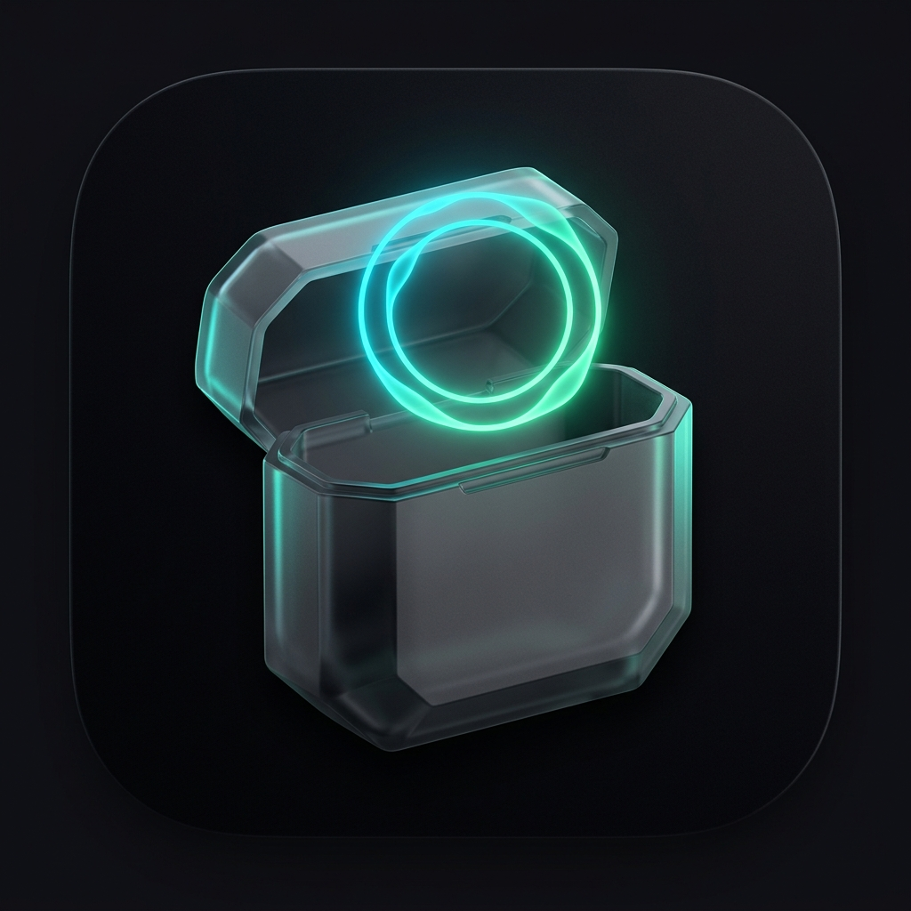
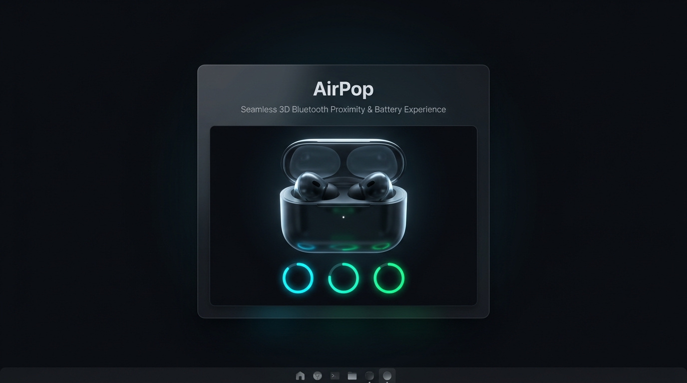

<div align="center">



# AirPop

**3D Bluetooth Proximity Popup, Universal Over-Ear & In-Ear Detection, Dynamic System Tray Battery Ring, and Listening-Mode Flyout built with Rust, Tauri 2, and React Three Fiber**

[](https://github.com/Ignaciobrenas/AirPop/releases)
[](https://github.com/Ignaciobrenas/AirPop/actions)
[](LICENSE)
[](#architecture)
[](#security--privacy)

<br />



</div>

---

##  Key Features

- **Universal Over-Ear (Headband) & In-Ear Detection**: Automatically identifies whether connected or nearby headphones are **Over-Ear Headband (`over-ear`)** or **True Wireless In-Ear (`earbuds`)** across major manufacturers (**Sony WH-1000XM5 / XM4 / WF-1000XM5**, **Bose QuietComfort Ultra Headphones & Earbuds**, **Sennheiser Momentum 4**, **Samsung Galaxy Buds3 Pro**, **Studio Pro**, **Pro 3**, **Series 4 / 4 ANC**, and **Max 2**).
- **Real-Time BLE Proximity Detection (`0x004C` / Multi-Vendor)**: Scans Bluetooth Low Energy advertisements, filters by signal strength (`RSSI > -60 dBm`), correlates devices via payload signature to handle rotating random MAC addresses (RPA), and enforces a 12-second per-device debounce.
- **Three Sculpted 3D Rigs at 60 FPS**: Powered by **React Three Fiber (Three.js)** with damped harmonic spring physics (`stepSpring`), studio 3-point lighting, and subtle mouse parallax:
  1. **Over-Ear Headband Rig (`over-ear-sculpted` & `over-ear-oval`)**: Padded headband arch, metallic telescopic sliders, swiveling earcups that unfold from travel pose to listening pose, and plush memory-foam ear cushions.
  2. **Stem In-Ear Rig (`stem-earbuds`)**: Contoured charging case with recessed metallic hinge, spring-opening lid (`case_lid`), and staggered floating earbuds (`bud_left`, `bud_right`).
  3. **Sculpted Stemless In-Ear Rig (`bud-in-ear`)**: Compact matte vault case with wide-opening lid and ergonomic acoustic buds featuring metallic touch-sensor caps.
- **Native Windows 10/11 Taskbar Integration**:
  - **Dynamic System Tray Icon**: Rendered in-memory via `tiny-skia` showing a color-coded battery ring for the lowest level among `L`, `R`, and `Case`.
  - **Acrylic / Mica Flyout**: Anchored to the tray icon with a segmented listening-mode selector (*Noise Cancellation*, *Transparency*, *Adaptive*, *Off*) using custom `1.75px` stroke SVG icons (`ui/src/shared/icons.tsx`) and model/colorway switchers.
  - **Anti-Spam Native Toasts**: Low-battery alerts (20% and 10%) and case fully charged notifications rate-limited to at most 1 toast per event and device every 30 minutes.
- **Zero Idle CPU & GPU Footprint**: Code-split frontend bundles (`Flyout` is `1.74 kB` gzipped and never loads Three.js), automatic `frameloop="never"` suspension when hidden, explicit Three.js geometry/material disposal on unmount, and native `SHQueryUserNotificationState` fullscreen game suppression.

---

##  Architecture

```text
┌──────────────────────────────────────────────────────────┐
│ Rust Core (Tauri 2)                                      │
│                                                           │
│  ble::scanner ──► ble::apple_proximity (parser)           │
│        │                     │                            │
│  bt::watcher (connection)    ▼                            │
│        │              device::registry (LRU/TTL catalog) │
│        ▼                     │                            │
│  state::machine ◄────────────┘                            │
│        │                                                  │
│        ├─► ipc (validated JSON) ──► popup window          │
│        ├─► tray (tiny-skia icon) ──► flyout window        │
│        ├─► toast (rate-limited notifications)             │
│        └─► settings (store) / autostart / single-instance │
│                                                           │
│  aap: L2CAP protocol (with automatic degradation on Win)  │
└──────────────────────────────────────────────────────────┘
                         │ IPC events & commands
                         ▼
┌──────────────────────────────────────────────────────────┐
│ UI (WebView2)                                             │
│  popup:  React + R3F + Damped 3D Spring Rigs (lazy chunk) │
│  flyout: React + Custom SVG Icon Library (1.74 kB gzip)   │
│  stores (zustand), tokens.css, spring.ts, .glb assets     │
└──────────────────────────────────────────────────────────┘
```

---

##  Model Catalog (`catalog/models.json`)

All 18 supported models, silhouettes, and colorways are defined declaratively in [`catalog/models.json`](catalog/models.json):

| Catalog ID | Display Name | Brand / Family | Form Factor | 3D Silhouette | Colorways |
|---|---|---|---|---|---|
| `sony-wh-1000xm5` | **Sony WH-1000XM5** | Sony | Over-Ear (Headband) | `over-ear-sculpted` | Black, Platinum Silver, Midnight Blue, Smoky Pink |
| `sony-wh-1000xm4` | **Sony WH-1000XM4** | Sony | Over-Ear (Headband) | `over-ear-sculpted` | Black, Silver |
| `sony-wf-1000xm5` | **Sony WF-1000XM5** | Sony | In-Ear | `bud-in-ear` | Black, Platinum Silver |
| `bose-qc-ultra-headphones` | **Bose QC Ultra** | Bose | Over-Ear (Headband) | `over-ear-sculpted` | Black, White Smoke, Sandstone, Lunar Blue |
| `bose-qc-ultra-earbuds` | **Bose QC Ultra Buds** | Bose | In-Ear | `bud-in-ear` | Black, White Smoke |
| `sennheiser-momentum-4` | **Sennheiser Momentum 4** | Sennheiser | Over-Ear (Headband) | `over-ear-sculpted` | Graphite, White, Copper |
| `beats-studio-pro` | **Studio Pro** | Studio | Over-Ear (Headband) | `over-ear-oval` | Matte Black, Sandstone, Navy, Deep Brown |
| `galaxy-buds3-pro` | **Galaxy Buds3 Pro** | Samsung | In-Ear | `stem-earbuds` | Metallic Silver, White |
| `airpods-pro-3` | **Pro 3** | GenericPro | In-Ear | `stem-earbuds` | White |
| `airpods-4` | **Series 4** | GenericPro | In-Ear | `stem-earbuds` | White |
| `airpods-4-anc` | **Series 4 ANC** | GenericPro | In-Ear | `stem-earbuds` | White |
| `airpods-max-2` | **Max 2** | GenericPro | Over-Ear (Headband) | `over-ear-oval` | Midnight, Starlight, Orange, Purple, Blue |
| `airpods-pro-2` | **Pro 2** | GenericPro | In-Ear | `stem-earbuds` | White |
| `airpods-pro-1` | **Pro 1** | GenericPro | In-Ear | `stem-earbuds` | White |
| `airpods-3` | **Series 3** | GenericPro | In-Ear | `stem-earbuds` | White |
| `airpods-2` | **Series 2** | GenericPro | In-Ear | `stem-earbuds` | White |
| `airpods-1` | **Series 1** | GenericPro | In-Ear | `stem-earbuds` | White |
| `airpods-max` | **Max** | GenericPro | Over-Ear (Headband) | `over-ear-oval` | Space Gray, Silver, Sky Blue |

---

##  Quick Start & CLI Usage

### Download Prebuilt Windows `.exe`
Download the standalone `airpop.exe` (or `airpop-windows-x64.exe` and `airpop-capture-windows-x64.exe`) directly from the latest [GitHub Release](https://github.com/Ignaciobrenas/AirPop/releases).

### Frontend Development & Testing
```bash
cd ui
npm install
npm run lint
npm test
npm run build
```

### Simulation Mode (`--simulate`)
Iterate on UI choreography or test any over-ear headband or in-ear model without physical hardware:
```bash
# Syntax: airpop --simulate <model> <color> <scenario>
airpop.exe --simulate sony-wh-1000xm5 black case-open
airpop.exe --simulate bose-qc-ultra-headphones sandstone connected
airpop.exe --simulate sennheiser-momentum-4 copper case-open
airpop.exe --simulate airpods-max-2 orange connected
airpop.exe --simulate airpods-pro-3 white charging
```

---

##  Performance & Resource Budget

| Metric | Target Budget | Implementation Strategy |
|---|---|---|
| **Idle CPU Usage** | `~0%` | 3D `<Canvas>` unmounts when hidden and sets `frameloop="never"` on background visibility |
| **Popup First Frame** | `< 150 ms` | Pre-initialized hidden overlay windows + vendor code-splitting |
| **Animation Frame Rate** | `60 fps` | Damped harmonic springs (`stepSpring` & `spring.ts`), `dpr={[1, 1.5]}`, and `powerPreference: "low-power"` |
| **Memory Overhead** | `< 100 MB` | Explicit GPU geometry/material disposal + bounded LRU/TTL device registry (`MAX_TRACKED_DEVICES = 32`) |
| **Accessibility** | `WCAG 2.1 AA` | `aria-live="polite"`, `Escape` key dismissal, and `prefers-reduced-motion` support |

---

##  Security & Privacy

- **Zero Telemetry & Offline-Only**: AirPop makes zero external network requests and collects no analytics or telemetry.
- **Strict Content Security Policy (CSP) & Tauri Capabilities**: Enforces a locked-down CSP (`default-src 'self'; connect-src ipc: http://ipc.localhost`) and least-privilege Tauri v2 capabilities (`src-tauri/capabilities/default.json`).
- **Allowlist IPC Validation**: Every IPC command validates `modelId`, `color`, and settings fields against the catalog allowlist and strict length bounds. See [`SECURITY.md`](SECURITY.md) for the full threat model.
- **100% Original Assets**: All 3D `.glb` meshes, `.webp` renders, custom `1.75px` stroke SVG icons (`ui/src/shared/icons.tsx`), and synthesized Web Audio chimes are original creations. No proprietary third-party models, renders, SF Symbols, audio files, or trademarks are used.

---

##  License

Distributed under the [MIT License](LICENSE).
